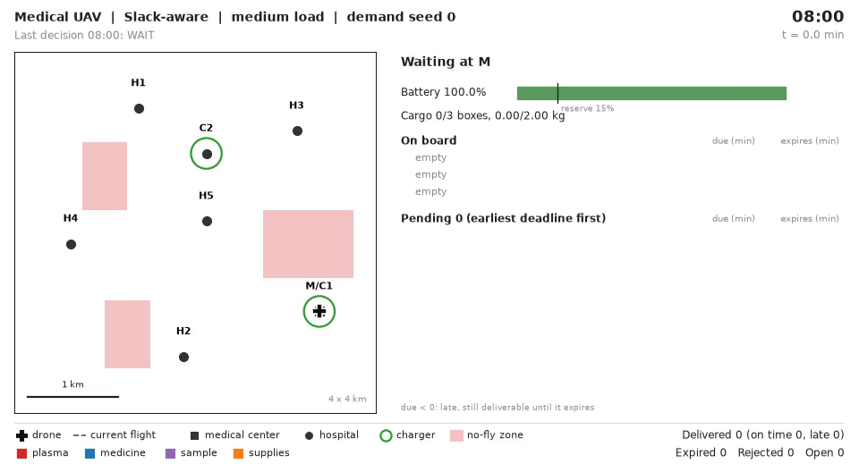

# Medical UAV Delivery Environment

A Gymnasium environment in which one drone picks up and delivers medical orders between a medical
center and five hospitals over one simulated day. Orders arrive at random and have deadlines; the
drone must avoid no-fly zones, carry at most 3 boxes and 2 kg, and never run out of battery. Three
baseline policies are included: random, earliest deadline first (EDF) and Slack-aware.

NUS ME5418, Group 17 (Jihang Cai, Yu Liu, Yufeng Zhang). Milestone 1: the environment.



## Requirements

- Conda (Miniconda or Anaconda) and an internet connection for the installation.
- Python 3.11 with numpy 2.4.6, gymnasium 1.4.0, matplotlib 3.11.2, imageio 2.38.1 and
  imageio-ffmpeg 0.6.0 (animation export; it includes FFmpeg). `environment.yml` installs all
  of them.
- Verified on Windows with Python 3.11.17 and the pinned packages below.

## Installation

Unzip the submission, open a terminal (Anaconda Prompt on Windows) in the folder that contains
`environment.yml`, and run:

```bash
conda env create -f environment.yml
conda activate medical-uav-rl
python -m pip install -e .
```

If an environment named `medical-uav-rl` already exists, add `-n <another name>` to the first
command and activate that name instead. Without conda, use Python 3.11 and run
`python -m pip install -r requirements.txt`, then `python -m pip install -e .`.

## Run the demo

```bash
python scripts/demo.py
```

This simulates one day with the Slack-aware policy (medium load, demand seed 0) and prints the
results, which start with:

```
Completed at 17:05 (t=545.8 min) after 113 decisions
  Orders   70 released: delivered 53/70 (75.7%), expired 17/70 (24.3%)
```

It then saves two files in `outputs/` (rendering may take several minutes):

- `demo_slack_medium_seed0_t182min.png`, a snapshot at 11:02
- `demo_slack_medium_seed0.gif`, the whole day

The demo prints the results before rendering the animation. It does not open a live window;
open the saved GIF in a browser to view it. A pre-rendered example is in `assets/demo.gif`.

| Option | Values |
|---|---|
| `--policy` | `slack` (default), `edf`, `random` |
| `--load` | `low`, `medium` (default), `high` |
| `--seed` | which day of orders (default `0`) |

`scripts/demo.py` is also the usage example: it creates the environment, starts a day, lets a
policy choose actions until the day is over, and then draws the day.

## The environment

| | |
|---|---|
| Observation | `Box(403)`: the drone, up to 12 waiting orders (those that can still be on time first) and the cargo on board |
| Action | `Discrete(26)`: pick up, deliver, charge, return to the center, wait; `info["action_mask"]` marks the allowed ones |
| Reward | +1 per on-time delivery, less when late, −0.5 per expired order, a small energy cost |
| Episode | one day, about 80–120 decisions |
| `reset` options | `demand_seed` (which day of orders), `load` (`"low"`, `"medium"` or `"high"`) |
| Baselines | `random_policy`, `edf_policy`, `slack_aware_policy` in `medical_uav.baselines.heuristics` |

Most settings (map, drone, demand, rewards) are in `medical_uav/env/config.py`; pass
`MedicalUAVEnv(config=EnvConfig(...))` to change them. The order types, the 12 slots and the charge
targets are fixed because they define the observation and action layout. Invalid numerical
settings, such as zero waiting duration or charge rate, are rejected with `ValueError`.
The rules, assumptions and changes from the proposal are described in the two-page `report.pdf`.

## Verification

```bash
python -m pytest -q
python scripts/calibrate.py --lambdas 0.04 0.09 0.12
```

Calibration uses map seed 0 and 40 development demand seeds (100000-100039), with the same
order streams for every policy. Final test seeds (200000-200099) are reserved for the later
learning-agent evaluation. `--seed` in the demo is the demand seed; changing it does not change
the map. The default `env.reset(seed=...)` instead seeds a draw of a training demand seed;
use `options={"demand_seed": ...}` to request a particular day directly.

Only twelve pending orders are individually observed; the remaining backlog is represented
by summary features. Episodes end when the 480-minute arrival window has closed and every
order is delivered or expired, without a mandatory return-to-base or cargo-cleanup phase.
The parameters define a synthetic benchmark. No trained RL agent is included in this milestone.

## Files

```
medical_uav/
  env/
    uav_env.py       MedicalUAVEnv, the Gymnasium environment
    config.py        settings
    simulator.py     simulation of one day
    actions.py       the 26 actions
    masks.py         which actions are allowed
    observation.py   the observation vector
    map_gen.py       random map generation
    astar.py         shortest path around no-fly zones
    orders.py        orders and the order stream of one day
    physics.py       flight time, energy, charging time, delivery reward
    render.py        drawing and animations
  baselines/
    heuristics.py    Random, EDF and Slack-aware policies
  metrics.py         per-day metrics
  splits.py          seeds for training, development and testing
scripts/
  demo.py            run and show one day; also the usage example
  calibrate.py       compare baselines on development seeds
tests/               API, simulator, safety, validation and rendering checks
report.pdf           two-page shared M1 report
environment.yml      conda environment
requirements.txt     the same packages for pip
pyproject.toml       package definition for `pip install -e .`
```

## Libraries and AI assistance

NumPy supplies numerical arrays and random sampling; Gymnasium supplies the environment API
and checker; Matplotlib draws the custom visualization; imageio and imageio-ffmpeg export
animations; pytest runs the tests. The dispatch simulator, map generation, grid A*, action masks,
features and baseline rules are implemented in this repository. No external robotics simulator
or RL training library is used in this milestone.

Claude assisted the earlier design and code development. OpenAI Codex assisted code review,
debugging, regression tests, verification and report drafting. ReportLab was used to typeset
the PDF and PyMuPDF to inspect its rendered pages; these report-production tools are not
runtime dependencies. The submission declares AI assistance in `report.pdf`.
