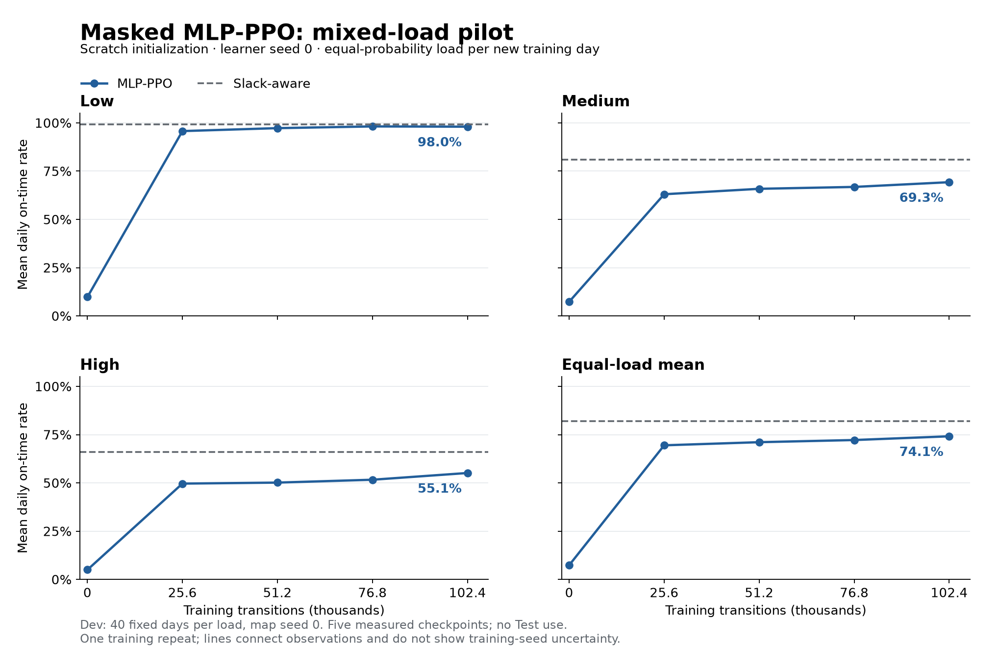

# Medical UAV Delivery Environment

**Current milestone: Generation 2 architecture comparison completed (26 October 2026).**
[Gen2 report](results/gen2_summary.md) · [new Test-v2](results/gen2_test_v2.md) · [architecture/reproduction notes](docs/gen2_architectures.md).
On the same new 100-day × three-load Test-v2, destination-conditioned DELIVER reaches
**85.90 ± 0.34%**, frozen M5 **85.02 ± 0.33%**, and relational attention **84.97 ± 0.36%**.
Destination − M5 is **+0.88 pp [95% paired interval +0.41,+1.37]**, positive for all five
learner pairs. Attention shows no clear gain. Canonical CPU batch-1 p50 is
185/259/348 µs for M5/destination/attention. Rates vary by load/type; no universal
or optimality claim is made. Both old Test and Test-v2 are consumed; all models,
protocols, full-day logs and first-generation results are retained. No method
changes followed Test-v2.

**Generation 1: M5 and frozen original Test completed (26 October 2026).**
[Full M5 report](results/m5_summary.md) · [Final Test results](results/final_test.md).
The final S1 structured method reaches **86.42 ± 0.37%** equal-load Test on-time
rate; Slack-aware reaches **82.12%**. The paired gap is **+4.30 pp** with a joint
95% learner/day bootstrap interval of **[+3.77, +4.83] pp**. SD is across five
learners. Test is now consumed; historical milestone sections below describe its
status at those earlier stages. Generation 1 models were frozen before the separate Generation 2 study.

A Gymnasium environment in which one drone picks up and delivers medical orders between a medical
center and five hospitals over one simulated day. Orders arrive at random and have deadlines; the
drone must avoid no-fly zones, carry at most 3 boxes and 2 kg, and never run out of battery. Three
baseline policies are included: random, earliest deadline first (EDF) and Slack-aware.

NUS ME5418, Group 17 (Jihang Cai, Yu Liu, Yufeng Zhang). Milestone 1: the environment;
Neural Network C&R: shared MLP and masked PPO development.


## Requirements

- Conda (Miniconda or Anaconda) and an internet connection for the installation.
- Python 3.11.17 with numpy 2.4.6, gymnasium 1.4.0, matplotlib 3.11.2, imageio 2.38.1,
  imageio-ffmpeg 0.6.0 (animation export; it includes FFmpeg), pytest 9.1.1 and
  PyTorch 2.10.0+cpu. `environment.yml` installs all of them.
- Tested on Linux.

## Installation

Unzip the submission, open a terminal (Anaconda Prompt on Windows) in the folder that contains
`environment.yml`, and run:

```bash
conda env create -f environment.yml
conda activate medical-uav-rl
python -m pip install -e .
```

If an environment named `medical-uav-rl` already exists, add `-n <another name>` to the first
command and activate that name instead. Without conda, use Python 3.11 and run
`python -m pip install -r requirements.txt`, then `python -m pip install -e .`.

Micromamba can also create the same environment without changing the system Python:

```bash
micromamba create -y -f environment.yml
micromamba run -n medical-uav-rl python -m pip install -e .
micromamba run -n medical-uav-rl python -m pytest -q
```

`requirements-lock.txt` records all resolved Python package versions from the
verified Linux CPU environment. After creating the Python environment, use
`python -m pip install -r requirements-lock.txt` to restore those transitive
dependency versions, then `python -m pip install -e .` to install this project.

## Neural network installation demo

```bash
python scripts/demo_network.py
```

The demo uses the shared `403 -> 256 -> 128` MLP with separate 26-action and
scalar-value heads (139,803 parameters). It collects 256 real environment transitions,
applies each observation's legal-action mask, computes GAE and performs one clipped
PPO cycle using the same collector/updater as the continuous trainer, then saves/reloads
a checkpoint with exactly matching outputs. It prints input/output shapes and timings;
the JSON record and checkpoint are in `outputs/network_smoke/`.

This is a CPU forward/backward and checkpoint demonstration, not evidence of
improved scheduling. It uses only Train demand seeds. The default
is one PyTorch CPU thread to avoid excessive thread overhead for this small model;
`--threads`, `--batch-size`, `--seed` and `--output-dir` are configurable.

The pinned PyTorch package is the official CPU build, so this environment does not
require CUDA or a working NVIDIA driver. GPU training can be configured separately
after the driver is working and CPU/GPU throughput has been compared.

## Neural Network C&R submission checklist

- One ZIP/RAR/7z per group containing commented source, a runnable network demo,
  this README and `environment.yml`, plus the group's two-page report.
- The report must explain the main code logic and organization, disclose external
  code/libraries/tools and adaptations, and include reflections/lessons learned
  and any changes to the proposal or remaining work.
- Acknowledge AI use explicitly, describing the tools and their actual uses. The
  group remains responsible for the submitted content and results.
- The supplied assignment screenshot shows Friday 30 October 2026 at 23:59 as the
  deadline. Verify the course portal's displayed timezone before uploading.

Experiments are complete through M5 and the frozen final Test. The group still
needs to prepare its final two-page submission report and archive.

AI-use disclosure for this development: OpenAI Codex assisted with environment
setup, actor–critic/PPO implementation, reproducibility checks, experiment
execution, inference optimization, statistical analysis, and draft documentation
and figures. The group remains responsible for reviewing the submitted code,
claims and report. This disclosure should accompany the final submission.

## Continuous PPO training and evaluation

Activate `medical-uav-rl` first, or prefix commands with
`micromamba run -n medical-uav-rl`. Run the Medium integration check with:

```bash
python scripts/train.py --config configs/ppo_medium_smoke.json --output-dir outputs/medium_seed0
python scripts/evaluate.py --checkpoint outputs/medium_seed0/best.pt --split dev \
  --output outputs/medium_seed0/best_dev.json
```

Each rollout contains 128 decisions from each of 8 environments, 1,024 total
transitions. One process advances the environments serially and batches network
inference. The 10,240-transition integration budget is exactly 10 updates.
`configs/ppo_mixed_pilot.json` is the completed 102,400-transition scratch pilot
configuration, evaluating every 25 updates (25,600 transitions). Its results are
recorded below; it is not a multi-seed main experiment.

The defaults are Adam at 3e-4, four PPO epochs, minibatches of 256, clip 0.2,
gamma 1, GAE lambda 0.95, value coefficient 0.5 times MSE (no extra 1/2), entropy
coefficient 0.01, gradient clipping at 0.5 and a target approximate KL of 0.02.
Advantage normalization is used only for the Actor; Critic targets use raw GAE.
The old observation, mask, action, probability and value are fixed throughout a
rollout's updates. A pre-update ratio check rejects stale or mismatched data.

The collector explicitly values the final post-action observation before reset.
True termination disables bootstrap and GAE recurrence. External truncation keeps
bootstrap but stops recurrence. A rollout boundary keeps bootstrap while ending
the current GAE recursion. Do not wrap the collector's environments in autoreset.

Training samples days only from 0..99999, with an optional `--train-seeds` subset
for debugging. Mixed training samples loads uniformly per new episode, so their
transition counts need not be equal. Load labels and actual `lam` are logged from
each reset rather than inferred from the environment's constructor.

`last.pt` is saved after each complete update. `best.pt` is selected only from
full Dev (100000..100039, all three loads): equal-load mean **daily** on-time rate,
then mean daily reward. Initial and final Dev evaluations are enabled; the default
periodic interval is 100 updates (102,400 transitions). Debugging with
`--eval-split train` does not create a best checkpoint. The trainer cannot use Test;
the standalone evaluator accepts `--split test` for an explicit frozen-model run.
No Test results are needed for integration acceptance.

The evaluator uses masked argmax for the neural policy and the same complete-day
metric function for PPO, Random, EDF and Slack-aware. It preserves global Python,
NumPy and Torch RNG states. Each Random baseline day has a separate generator,
so evaluation ordering does not change its behavior. Training and evaluation use
separate environment instances on the same map (map seed 0 by default).

Run directories must be fresh. They contain:

- `metadata.json`, `config.json`, `source_manifest.json` and `source.tar.gz`:
  source commit/working state, source snapshot, exact dependencies, full environment
  settings, seeds and model-selection convention.
- `updates.jsonl`: transitions, losses, entropy, KL, clipping, gradient norm,
  explained variance, raw advantage/return scales and separate stage timings.
- `episodes.jsonl`: completed training episodes, their load/day, per-type counts,
  reward, action counts, action minutes and simulation activity minutes. Partial
  external truncations are explicitly labelled incomplete.
- `evaluation_episodes.jsonl`, `evaluations.jsonl`, `summary.json`: full-day
  evaluations, equal-load summaries and the final run status.
- `last.pt`, and `best.pt` when a Dev candidate improves. An exception produces
  `failure.json` and diagnostic inputs; it never silently continues a failed run.

Every evaluation also saves `checkpoint_<nine-digit-transition-count>.pt`,
including step 0. Update logs record the current fixed learning rate and per-load
opened-day counters; final summaries separate collection, GAE, PPO, evaluation,
checkpoint and remaining wall-clock costs. Opened-day counts include active days
at the budget boundary. When resuming older checkpoints without these counters,
`started_counts_include_history=false` discloses the missing earlier history.

Checkpoint continuation restores model, optimizer, Python/NumPy/Torch RNG states,
minibatch-shuffle RNG and training day/load sampler. It starts **new training
days** and records discarded partial days; it does not reproduce an interrupted
simulator trajectory exactly. Continue into a fresh output directory, changing
only the total budget:

```bash
python scripts/train.py --resume outputs/medium_seed0/last.pt --total-steps 20480 \
  --output-dir outputs/medium_seed0_continued
```

A resumed Dev run copies the matching earlier `best.pt` into the new directory;
keep it alongside `last.pt` when moving a run before continuation. Its summary
identifies the inherited best unless a new best was selected. Compare
architectures with the same total budgets, evaluation schedules and learner seeds.
One short run demonstrates integration, not superiority to Slack or generalization.

Compare CPU thread counts using separate processes, five warmup updates and twenty
measured updates per setting:

```bash
python scripts/benchmark_training.py --output-dir outputs/thread_benchmark
```

The benchmark logs complete training-cycle stage costs, checkpoint costs and final
evaluation wall time. It compares one sequential pass each at 1, 2 and 4 Torch
threads; other applications and power/thermal conditions can affect the timings.

Core modules are `medical_uav/agents/networks.py` (policy),
`algorithms/{rollout_buffer,returns,ppo}.py`, `training/{collector,trainer}.py`,
and `evaluation/evaluate.py`. The existing environment, reward and action ordering
are unchanged. The implementation follows [PPO](https://arxiv.org/abs/1707.06347)
and [Gymnasium termination/truncation semantics](https://gymnasium.farama.org/tutorials/gymnasium_basics/handling_time_limits/).

### Local integration acceptance, 26 October 2026

Source commit `b76f9bf`, Ubuntu 22.04.5, i7-12800H, Python 3.11.17 and PyTorch
2.10.0+cpu: the Medium-only learner-seed-0 run completed 10,240 transitions,
10 updates and 88 complete training days, with zero illegal actions. Its total
wall time was 13.41 seconds including initial PPO/Random/EDF/Slack Dev evaluation
and final PPO Dev evaluation. The largest pre-update probability-ratio error was
7.16e-7. The final suite passed all 169 tests in 17.30 seconds.

Each cell below is the mean daily on-time rate across the same 40 Dev days.
The final PPO model was selected by the documented full-Dev rule.

| Policy/checkpoint | Low | Medium | High |
|---|---:|---:|---:|
| PPO initialization | 9.80% | 7.33% | 5.00% |
| PPO after 10,240 Medium transitions | 94.91% | 59.58% | 46.41% |
| EDF | 99.56% | 40.56% | 27.47% |
| Slack-aware | 99.26% | 80.99% | 65.89% |

This establishes a learning response in one short development run. It does not
establish superiority to Slack-aware, stable performance across learner seeds,
or final Test generalization. No Test day was used. Random results and the full
configuration are recorded in [the acceptance record](results/ppo_integration_2026-10-26.json).

Loading `best.pt` in the standalone evaluator reproduced all 120 PPO Dev day
records exactly. A separate continuation reached 11,264 transitions/11 updates,
with optimizer steps continued and the inherited best copied unchanged. The
continuation discarded eight partial days as declared by the resume convention.

The full-cycle thread benchmark used five warmup plus twenty measured updates per
setting. Mean collection + GAE + PPO + checkpoint time per 1,024 transitions was
0.2252 seconds (1 thread), 0.2106 (2), and 0.2155 (4), excluding evaluation.
One model-only full Dev evaluation took 3.04 seconds in the integration run.
The short benchmark favors two threads slightly; one remains the conservative
default. Runtime estimates for larger experiments must include evaluation and
allow for changing policy behavior and other workloads.

Raw run/checkpoint artifacts are local under `outputs/ppo_medium_10240_seed0/`,
continuation under `outputs/ppo_medium_resume_11264_seed0/`, tests under
`outputs/ppo_validation/`, and thread measurements under
`outputs/ppo_thread_benchmark/`. These generated directories are ignored by Git;
keep them with the tracked acceptance record when preparing the submission.
The subsequent mixed-load pilot and five-seed M3 experiment are recorded below.
Structural-network comparison, the two-page report and submission archive remain
subsequent stages.

### Mixed-load pilot, 26 October 2026

The preregistered scratch run used learner seed 0, source commit `9454004`, the
accepted MLP/PPO settings and one CPU thread. Each new training day independently
draws Low/Medium/High with equal probability. Fixed Adam learning rate 3e-4 was
verified in all 100 update records. No Medium checkpoint was loaded and no Test
days were read. Network, reward, observation, action set and PPO objective were
unchanged; this stage added only configuration, checkpoint retention and logging.

The following are mean daily on-time rates over the same full Dev set: 40 days per
load at each of the five points, with all loads weighted equally for the mean.

| Transitions | Low | Medium | High | Equal-load mean |
|---:|---:|---:|---:|---:|
| 0 | 9.80% | 7.33% | 5.00% | 7.37% |
| 25,600 | 95.75% | 63.03% | 49.64% | 69.47% |
| 51,200 | 97.28% | 65.85% | 50.15% | 71.09% |
| 76,800 | 98.16% | 66.82% | 51.64% | 72.21% |
| 102,400 | 98.02% | 69.27% | 55.13% | 74.14% |



**Best and last are both at 102,400 transitions and have identical model
parameters.** Over the last 25,600 transitions, Medium improved 2.45 percentage
points and High 3.49; Low decreased 0.14 points. This is continued improvement in
the observed Medium/High checkpoints, with only a small final Low movement. One
seed cannot establish the statistical reliability of those changes. Slack-aware
remains higher at 99.26%/80.99%/65.89%, or 82.05% across loads; the pilot's equal-load
gap is 7.90 points. Nothing here isolates a causal benefit from mixed loads,
because the budget increased relative to the Medium integration run as well.

Actual training-day/transition counts were:

| Load | Opened days | Complete days | Active days at end | Transitions | Transition share |
|---|---:|---:|---:|---:|---:|
| Low | 320 | 316 | 4 | 30,333 | 29.62% |
| Medium | 329 | 328 | 1 | 35,069 | 34.25% |
| High | 330 | 327 | 3 | 36,998 | 36.13% |

Opened-day shares were 32.69%/33.61%/33.71%. Equal-probability day sampling does not
imply equal transition counts. The 971 complete episodes and eight active days
reconcile to every one of the 102,400 transitions. Training per-load mean reward
and on-time rate are retained in [the full pilot record](results/ppo_mixed_pilot_seed0.json);
these pool evolving stochastic policies and are not substitutes for the Dev rows.

The run had zero illegal actions, finite recorded losses/advantages/returns and
finite tensors in all five model/optimizer checkpoints. The maximum pre-update
ratio error was 2.63e-6; final rollout KL ranged 0.00096..0.01425 and no update hit
the target-KL early-stop threshold. All 1,600 planned minibatch steps completed.
Explained variance at the final update was 0.969. Existing PPO integration tests
(13 cases) passed with the new logging/checkpoint assertions.

| Timing component | Seconds |
|---|---:|
| Collection + GAE + PPO | 21.99 |
| Dev evaluation and evaluation-record writes | 19.45 |
| Checkpoint writes | 0.23 |
| Initialization, other logging and remaining overhead | 0.73 |
| Total wall time | 42.40 |

Initial evaluation includes the three rule/random baselines (360 additional Dev
days). The four subsequent model-only full Dev evaluations took about 2.96..3.14
seconds each; there were 600 PPO Dev days and no Test days in total.

The pilot met engineering health criteria. The same setup was retained for the M3
experiment below, with five fresh learner seeds 1..5, each with 1,024,000
transitions and Dev every 102,400. An equal-budget Medium control is needed before
attributing any gain specifically to load mixing; it is not required to claim
this pilot learned under the mixed distribution.

Raw logs, source snapshot, five archived checkpoints, `best.pt` and `last.pt` are
under `outputs/ppo_mixed_102400_seed0/`. The JSON record and PNG/SVG figures are
tracked. Reproduce the analysis from the local raw run with:

```bash
python scripts/analyze_pilot.py --run-dir outputs/ppo_mixed_102400_seed0 \
  --output results/ppo_mixed_pilot_seed0
```

### M3 — Multi-seed MLP-PPO Baseline, 26 October 2026

**Completed:** scratch learner seeds 1, 2, 3, 4 and 5 each ran the full 1,024,000
transitions / 1,000 updates. No network, observation, action mask, reward or PPO
setting was changed after the pilot. One CPU thread and a constant 3e-4 learning
rate were retained. The protocol/configurations were committed before training
at source commit `6ba5af2`; frozen file hashes are in
[`configs/m3_protocol.json`](configs/m3_protocol.json).

Every run retained 11 full-Dev checkpoint models (0, then every 102,400 transitions),
plus `best.pt` and `last.pt`. Best selection uses the previously fixed equal-load
mean daily on-time rate, reward tie-breaker, and earlier checkpoint for an exact
tie. All runs finished their fixed budgets irrespective of interim scores.

The primary Dev results below use each seed's independently selected best model.
SD is sample SD across five learner seeds (ddof=1), in percentage points; no
pooled-day confidence interval is implied.

| Model | Low | Medium | High | Equal-load mean |
|---|---:|---:|---:|---:|
| MLP-PPO, best mean ± SD | 98.68% ± 0.39 | 74.31% ± 0.97 | 60.93% ± 1.33 | 77.97% ± 0.49 |
| MLP-PPO, last mean ± SD | 98.52% ± 0.51 | 73.68% ± 1.25 | 59.44% ± 1.48 | 77.22% ± 0.98 |
| Slack-aware | 99.26% | 80.99% | 65.89% | 82.05% |
| EDF | 99.56% | 40.56% | 27.47% | 55.86% |
| Random, canonical seed-0 baseline | 51.14% | 23.55% | 21.28% | 31.99% |

The full [M3 result table and analysis](results/m3_mlp_ppo.md) reports all five
seeds, best checkpoint positions, last results, paired comparisons and timings.
The fixed common baseline uses the pilot's same 120 Dev scenarios; formal-run
Random repeats remain in the raw logs but do not replace that preregistered row.


The pointwise equal-load mean increased from 73.79% at 102,400 transitions to
77.22% at 1,024,000, a 3.42-point increase; Medium/High increased 4.23/5.36 points.
The final three pointwise means were 77.12%, 77.27% and 77.22%, showing a much
flatter late trajectory. This is an observed plateau/variation over those
checkpoints, not proof of convergence. Four seeds selected a best checkpoint
before the final budget. Seed 4 had the largest best-to-last loss (2.32 points),
even while mean daily reward increased 0.549; its Medium/High served rates rose
while on-time rates fell. This supports examining objective/service tradeoffs,
without changing the frozen experiment or attributing the change to one mechanism.

The best-model paired daily gaps against Slack averaged -0.59 points on Low,
-6.68 on Medium, and -4.97 on High. Of the 200 matched seed/day pairs per load,
PPO won/tied/lost 30/11/159 on Medium and 39/12/149 on High. Twenty Medium Dev
days and seventeen High days were losses for all five seeds, so the remaining
gap is not confined to a single unlucky learner or one isolated day.


All 5,000 update records had zero illegal actions and finite key training
diagnostics; all 55 model/optimizer checkpoint states passed finite-tensor checks.
There were 47,780 complete training episodes and 6,600 PPO Dev episode records.
No Test evaluation was performed. Training stages took 1,149.54 seconds, Dev
evaluation/logging 202.68 seconds, and the full serial orchestration 1,376.24
seconds (22.94 minutes), including startup and saves.

Artifacts:

- [`results/m3_mlp_ppo.json`](results/m3_mlp_ppo.json): all 55 checkpoint scores,
  cross-seed statistics, per-seed sampling/diagnostics/timings and provenance.
- [`results/m3_mlp_ppo_paired.json`](results/m3_mlp_ppo_paired.json): 1,200 matched
  best/last seed/load/day comparisons, with both policy rates and their difference.
- PNG/SVG versions of both figures are tracked under `results/`.
- `outputs/m3_mixed_mlp_ppo/`: protocol manifest, five raw run directories, logs,
  exact dependencies, source archives, all checkpoint models and daily records.
  Generated raw artifacts remain local and are ignored by Git.

Reproduction commands (choose a new output directory for another training run):

```bash
python scripts/run_m3.py --output-dir outputs/m3_mixed_mlp_ppo_reproduction
python scripts/analyze_m3.py --run-dir outputs/m3_mixed_mlp_ppo --output results/m3_mlp_ppo
```

These are results for this MLP/observation/action/reward/training protocol, selected
on reused Dev. They do not show that PPO generally loses to heuristics. The next
comparisons can use the same budgets/seeds and Dev opportunity: equal-budget
Medium-only versus Mixed, then the shared-order encoder. Test should remain
unopened until candidate methods and their comparison protocol are fixed.

## Run the demo

```bash
python scripts/demo.py
```

This simulates one day with the Slack-aware policy (medium load, demand seed 0) and prints the
results, which start with:

```
Completed at 17:05 (t=545.8 min) after 113 decisions
  Orders   70 released: delivered 53/70 (75.7%), expired 17/70 (24.3%)
```

It then saves two files in `outputs/` (about one minute):

- `demo_slack_medium_seed0_t182min.png`, a snapshot at 11:02
- `demo_slack_medium_seed0.gif`, the whole day

| Option | Values |
|---|---|
| `--policy` | `slack` (default), `edf`, `random` |
| `--load` | `low`, `medium` (default), `high` |
| `--seed` | which day of orders (default `0`) |

`scripts/demo.py` is also the usage example: it creates the environment, starts a day, lets a
policy choose actions until the day is over, and then draws the day.

## The environment

| | |
|---|---|
| Observation | `Box(403)`: the drone, up to 12 waiting orders (those that can still be on time first) and the cargo on board |
| Action | `Discrete(26)`: pick up, deliver, charge, return to the center, wait; `info["action_mask"]` marks the allowed ones |
| Reward | +1 per on-time delivery, less when late, −0.5 per expired order, a small energy cost |
| Episode | one day, about 80–120 decisions |
| `reset` options | `demand_seed` (which day of orders), `load` (`"low"`, `"medium"` or `"high"`) |
| Baselines | `random_policy`, `edf_policy`, `slack_aware_policy` in `medical_uav.baselines.heuristics` |

Most settings (map, drone, demand, rewards) are in `medical_uav/env/config.py`; pass
`MedicalUAVEnv(config=EnvConfig(...))` to change them. The order types, the 12 slots and the charge
targets are fixed because they define the observation and action layout. The rules of the
environment are described in the report, `ME5418_Group17_M1_Report.pdf`.

## Files

```
medical_uav/
  env/
    uav_env.py       MedicalUAVEnv, the Gymnasium environment
    config.py        settings
    simulator.py     simulation of one day
    actions.py       the 26 actions
    masks.py         which actions are allowed
    observation.py   the observation vector
    map_gen.py       random map generation
    astar.py         shortest path around no-fly zones
    orders.py        orders and the order stream of one day
    physics.py       flight time, energy, charging time, delivery reward
    render.py        drawing and animations
  baselines/
    heuristics.py    Random, EDF and Slack-aware policies
  metrics.py         per-day metrics
  splits.py          seeds for training, development and testing
scripts/
  demo.py            run and show one day; also the usage example
assets/
  demo.gif           the default demo day (the animation at the top of this page)
  demo.png           its frame at 11:02 (Figure 2 of the report)
ME5418_Group17_M1_Report.pdf   the two-page report
environment.yml      conda environment
requirements.txt     the same packages for pip
pyproject.toml       package definition for `pip install -e .`
```


## M4: shared-order architecture comparison (Dev only)

M4-A reproduced both Random protocols on the same 120 Dev demand days. The old
`default_rng(day)` and current isolated `SeedSequence([learner_seed,day,load_index,map_seed])`
produce different legal-action sequences, with identical orders. No MLP retraining
was required. The [diagnostic](results/m4a_diagnostics.md) compares reward, service,
charging, batching, congestion and update windows; behavior is descriptive because
policies visit different states.

The structured network follows the supplied 31 + 12×27 + 3×16 layout. Global,
pending and cargo encoders use Tanh hidden layers; presence-masked means feed a
128-dimensional context. A shared PICK scorer preserves order/output correspondence.
Real but currently unpickable orders remain in the context. All absent embeddings
are masked after the biased encoder. The architecture contains 65,232 parameters
versus the MLP's 139,803. Checkpoints carry an explicit architecture identifier;
old MLP checkpoints remain supported. The historical M3 implementation and current
MLP produce bit-identical forward/act results on 256 archived real observations.

The seed-0 [pilot](results/m4_structured_pilot.json) completed 102,400 transitions
and five full-Dev checkpoints, reaching 81.25% equal-load on-time rate. This was an
engineering/learning-response gate, with no MLP-relative threshold. Structural
acceptance covers empty sets, presence versus feasibility, order/cargo permutation,
masked probabilities, real PPO updates, resume and checkpoint rejection.

The [frozen M4 protocol](configs/m4_protocol.json) changes only the network choice
in each M3 learner configuration. Environment, reward, slots, masks, collector,
GAE, PPO loss, hyperparameters, constant LR, evaluation and selection are unchanged.
Five scratch seeds (1–5), each 1,024,000 transitions and 11 full-Dev checkpoints:

```bash
python scripts/run_m4.py --output-dir outputs/m4_structured_ppo
```

Five independent CPU learner processes each use one torch thread. M3 was serial,
so elapsed completion time is not an architecture speed comparison. Formal logs
retain process CPU time and actual throughput. An isolated one-thread inference
[benchmark](results/m4_inference_benchmark.json) uses identical real observations;
parameter count is not treated as a compute-cost proxy. Test remains unused.

### M4 completed results — 26 October 2026

All five new structured learners completed 1,024,000 transitions / 1,000 updates,
with 55 full-Dev checkpoints retained. The formal training source is `8a5a76a`.
All runs passed legal-action, finite-diagnostic, checkpoint and complete-day audits.
The 800 best/last Medium/High behavior replays reproduced saved reward and on-time
results exactly; standalone checkpoint reload also reproduced all record fields on
four matched Dev days.

| Selected best model | Low | Medium | High | Equal-load mean |
|---|---:|---:|---:|---:|
| Frozen MLP | 98.68 ± 0.39% | 74.31 ± 0.97% | 60.93 ± 1.33% | 77.97 ± 0.49% |
| Structured | 99.69 ± 0.26% | 85.75 ± 0.62% | 74.30 ± 0.88% | **86.58 ± 0.22%** |
| Slack-aware | 99.26% | 80.99% | 65.89% | 82.05% |

The five corresponding learner improvements are +8.98 / +8.02 / +8.12 / +8.76 /
+9.17 pp: mean **+8.61 ± 0.51 pp** versus MLP and **+4.53 pp** versus Slack's
Dev mean. All SD values describe five learner seeds (ddof=1), not confidence
intervals or pooled episode uncertainty. Medium improves on 185/200 matched
seed-day pairs and High on 196/200. Both gains accompany more batching and less
expiry after pickup; behavior remains descriptive because policies visit different
states. This comparison does not isolate parameter count from structural bias.

All five best checkpoints occur before the final step. The last-model mean is
84.80 ± 1.29%, below selected best by 1.78 pp. Reward rises slightly while
Medium/High on-time rate falls and expiry declines, so convergence is not claimed.
The five concurrent single-thread CPU runs finished in 998.13 seconds; this is
not directly comparable to M3's serial elapsed time. CPU and training-stage costs
are reported separately.

- [Complete result table and interpretation](results/m4_structured.md)
- [Full learning curves](results/m4_structured_curves.png) and [post-100k detail](results/m4_structured_tail_curves.png)
- [Matched-day differences](results/m4_structured_paired.png), with all best/last daily differences in [JSON](results/m4_structured_paired.json)
- [Summary and behavior](results/m4_structured.json) and [complete checkpoint/training audit](results/m4_structured_audit.json)

Raw checkpoints, source archives, all evaluation days, update/episode logs and
behavior replay days remain under `outputs/m4_structured_ppo/`. The M3 directory
was preserved. Reproduce the analysis locally with:

```bash
python scripts/analyze_m4.py --run-dir outputs/m4_structured_ppo \
  --output results/m4_structured
```

Test is still unused. No PPO/reward/slot/architecture tuning followed the pilot,
and no other ablation was added to this comparison.

## M5: bounded stability tuning and final validation

M4 is retained as S0 with all existing checkpoints/results unchanged. A preflight
scan of 152 recorded output files found no prior use of demand seeds 100040–100139.
These are now **Dev-extra**, explicitly available for diagnosis/configuration
comparison, never a held-out Test. Dev-main 100000–100039 alone still selects each
learner's single best checkpoint for every load. Test 200000–200099 remains sealed
until a separate final-comparison protocol freezes all model hashes and statistics.

[Pre-tuning diagnostics](results/m5_initial_diagnostics.md) reproduce all M4
Dev-main scores and include per-seed/load/type counts, unpicked/picked expiry,
effective-drop numerators/denominators, and event-weighted battery/payload
histograms. On Dev-extra, M4 best is 85.96%, MLP best 77.45%, and Slack 81.47%.
M4 last is 84.51%; all five best-to-last declines also occur on these extra days.

The existing LR is constant 3e-4. The target-KL threshold 0.02 really stops all
remaining joint optimizer updates for that rollout. Late KL/score change does not
show the hypothesized negative association; S2 is therefore not run in this finite
round. S1 changes **only the LR schedule**: updates 1–500 retain 3e-4, then linear
decay to 3e-5 at update 1000. No entropy/reward/architecture/slot change is included.
Exact categorical KL and normalized entropy are diagnostic additions; a frozen M4
updater regression verifies identical model tensors and original update statistics.

The [M5 protocol](configs/m5_protocol.json) fixes complete 1,024,000-step runs,
11 full-Dev checkpoints and the original selection rule. Seeds 1–3 run first;
seeds 4–5 are conditional on all preregistered gates. The engineering gates require
main best no more than 0.3 pp lower, last and tail each at least 0.3 pp higher,
extra best no more than 0.3 pp lower, extra last nondecreasing, and no severe
per-load/type extra best regression (2/3 pp tolerances). These are practical
selection rules, not significance or noninferiority tests. Otherwise retain S0
and stop tuning. No combination search is planned.

```bash
python scripts/run_m5.py --stage development --output-dir outputs/m5_s1_development_123
# Only after the frozen gate passes:
python scripts/run_m5.py --stage extension --output-dir outputs/m5_s1_extension_45
```

PICK projection reuse and argmax-only evaluation will be treated separately as
engineering changes. They must pass numerical, action and complete-day checks
before benchmarking; the training network and on-policy data will remain separate.

### M5 finite tuning completed

The preregistered seeds 1–3 gate passed, so seeds 4–5 also completed from scratch.
All five reached 1,024,000 transitions; their midpoint tensors and collector state
exactly match corresponding M4 runs. Training source is `e333eac`; optional
inference/statistics modules were developed separately and did not alter its frozen
training files. All 55 S1 checkpoints passed finite, source, budget and selection
audits. Relative to the corresponding M4 learners, mean Dev-main changes are
+0.14 pp (best), +1.48 pp (last) and +0.92 pp (tail). Dev-extra changes are +0.12 pp
(best) and +1.36 pp (last). Per-type changes include tradeoffs; no claim is made
that every class improves. See [the fixed development gate](results/m5_development_gate.json)
and [all five tuning runs](results/m5_tuning.json).

Optional fast development evaluation preserves the original checkpoint weight keys:

```bash
python scripts/evaluate_fast.py --checkpoint outputs/m5_s1_development_123/seed_1/best.pt \
  --split dev --output outputs/my_fast_dev.json
```

This separate action-only path uses context projection reuse, inference mode and a
near-tie fallback. It is never used by the collector/PPO optimizer. Full-Dev
numerical/action/day equivalence and isolated B=1/B=8 p50/p95 timing are recorded
before the final Test freeze. The scientific Test will use the canonical evaluator.

The isolated inference measurement verified 1,800 complete Dev days over 15
checkpoints, with every action and serialized day metric unchanged. Maximum
PICK-logit error was 3.81e-6, value error zero. Original structured B=1 p50/p95 was
201.87/216.11 µs; factored argmax was 149.62/156.20 µs. Argmax-only was slightly
faster at B=1 (141.19 µs p50), so the MAC reduction is not presented as proportional
CPU speedup. Full Dev (120 days, 12,721 decisions) median time fell from 4.434 to
3.694 s. [All latency/equivalence measurements](results/m5_inference.json) include
B=8 throughput and the timing scope.

### Frozen final Test completed

The final comparison protocol was committed at `8959ab3` **before** Test was
opened. S1 was selected using development data, and all five Dev-main-selected
checkpoints per method were fixed by hash. The Test suite reran 100 new demand days
at each load for MLP, M4 S0 and S1, plus Slack, EDF and the fixed seed-0 Random
protocol: 5,400 complete episodes, 584,040 decisions, zero illegal actions. The
canonical evaluator was retained for scientific comparison.

| Test method | Low | Medium | High | Equal-load mean |
|---|---:|---:|---:|---:|
| MLP | 98.04 ± 0.75% | 76.39 ± 0.97% | 58.72 ± 1.49% | 77.72 ± 0.76% |
| M4 structured S0 | 99.10 ± 0.33% | 86.61 ± 0.81% | 72.94 ± 0.85% | 86.22 ± 0.32% |
| Final structured S1 | 99.41 ± 0.13% | 87.00 ± 0.50% | 72.84 ± 1.05% | **86.42 ± 0.37%** |
| Slack-aware | 99.57% | 81.66% | 65.12% | 82.12% |

S1 − Slack is +4.30 pp, with paired crossed-bootstrap 95% interval
[+3.77, +4.83] pp. M4 − MLP remains +8.50 pp [ +7.78, +9.23 ].
S1 − M4 is +0.20 pp [−0.17, +0.61], so there is no clear additional selected-model
Test gain. The M5 contribution is the demonstrated main/extra development-set
last/tail stability improvement while retaining the structural Test advantage.
Low does not show a clear advantage over Slack; Medium/High provide the final gain.

[All seed/load/type results](results/final_test.md), [paired Test figure](results/final_test_paired.png),
[complete M5 report](results/m5_summary.md) and [S1 learning curves](results/m5_tuning_curves.png)
retain denominators, failure modes, compute measurements and the limited tuning
budget. Bootstrap uses 10,000 predeclared paired learner/day resamples, preserving
day IDs across loads; pointwise intervals do not treat 1,500 records as independent
training repetitions. Five learners limit uncertainty estimation.

Raw final data and the frozen protocol/manifest remain under `outputs/final_test/`.
Reproduce reports without reevaluating Test or changing models:

```bash
python scripts/analyze_final.py --run-dir outputs/final_test --output results/final_test
python scripts/write_m5_report.py
```

Test is now used. Future model changes would be a new exploratory phase, and the
same Test could not be described as untouched.
