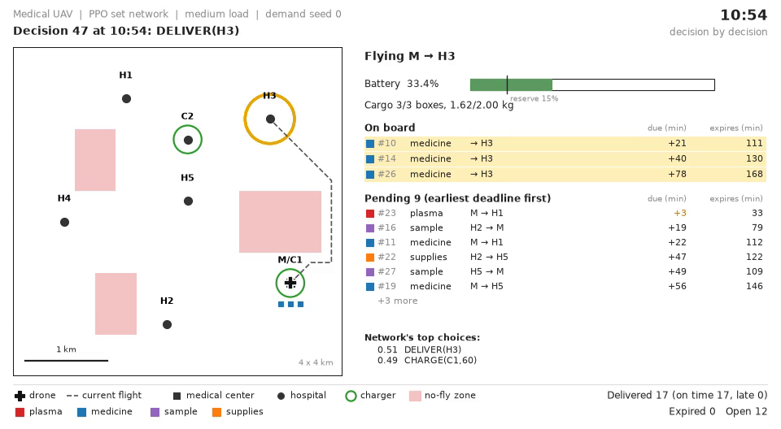

# Medical UAV Delivery: Environment and Policy Networks

A Gymnasium environment in which one drone picks up and delivers medical orders between a medical
center and five hospitals over one simulated day. Orders arrive at random and have deadlines; the
drone must avoid no-fly zones, carry at most 3 boxes and 2 kg, and never run out of battery.

NUS ME5418, Group 17 (Jihang Cai, Yu Liu, Yufeng Zhang). Milestone 2: the neural network.

## What Milestone 2 adds

| | Where | Section |
|---|---|---|
| Two policy/value networks: a set/attention network and an MLP control, both with action masking | `medical_uav/agents/networks.py`, `policy.py` | [The networks](#the-networks) |
| **Network demo**: both networks, a forward and a backward pass on real observations, a day driven by each trained network | `scripts/demo_network.py` | [Run the network demo](#run-the-network-demo) |
| Both networks trained by behaviour cloning of the strongest rule, with the trained weights | `medical_uav/agents/bc.py`, `scripts/train_bc.py`, `checkpoints/` | [The networks](#the-networks) |
| Environment v2 (reward, travel times in the observation), FCFS and nearest-first rules, an evaluator for comparing policies on the same days | `medical_uav/env/`, `medical_uav/baselines/`, `scripts/evaluate.py` | [The environment](#the-environment) |
| Visualisation of the network's decisions: a replay web page and two paced videos, made because the Milestone 1 animation was too fast to follow | `scripts/demo.py`, `assets/` | [Visualisation](#visualisation-included-results-and-how-to-make-them) |



## Requirements

- Conda (Miniconda or Anaconda) and an internet connection for the installation.
- Python 3.11 with numpy 2.4.6, gymnasium 1.4.0, matplotlib 3.11.2, imageio 2.38.1,
  imageio-ffmpeg 0.6.0 (video export; it includes FFmpeg) and torch 2.14.1 (CPU build).
  `environment.yml` installs all of them; no GPU is needed.
- Tested on Linux.

## Installation

Unzip the submission, open a terminal (Anaconda Prompt on Windows) in the folder that contains
`environment.yml`, and run:

```bash
conda env create -f environment.yml
conda activate medical-uav-rl
python -m pip install -e .
```

If an environment named `medical-uav-rl` already exists, add `-n <another name>` to the first
command and activate that name instead. Without conda, use Python 3.11 and run
`python -m pip install -r requirements.txt`, then `python -m pip install -e .`.

## Run the network demo

```bash
python scripts/demo_network.py
```

It creates both networks, runs a forward pass and a backward pass on real observations from the
environment, and lets the trained networks (in `checkpoints/`) run a whole day. It takes a few
seconds, prints to the terminal only (no files are saved) and shows, among other things:

```
3. forward pass (trained set network): logits (64, 26), value (64,)
   decision 30: PICK sample H3->M 0.83, DELIVER(M) 0.12, DELIVER(H1) 0.05   (Slack-aware chose PICK sample H3->M)
      their logits: PICK sample H3->M 15.71, DELIVER(M) 13.74, DELIVER(H1) 12.95;  value estimate -0.237 (untrained: BC does not train the value head)
4. backward pass (untrained set network): policy loss 1.849, value loss 13.408
   after one Adam step the loss falls from 8.553 to 8.509
5. A whole day (medium load, demand seed 100000) driven by each trained network
   BC mlp network (validation accuracy 0.935): 95.9% on time
   BC set network (validation accuracy 0.939): 91.8% on time
   Slack-aware (the teacher) on the same day: 95.9% on time
```

## Visualisation: included results and how to make them

### Included results (nothing to install)

The submission already contains a replay and two videos in `assets/`. Download
`assets/replay_set_network.html` and open it in a web browser (double-click; no installation or
internet connection is needed). It replays one day, medium load and demand seed 100000 (a day the
network never trained on), driven by the set network trained by imitation: play, pause, step from
decision to decision or drag the timeline. Each decision is shown with the situation it was taken
in and the network's three most likely actions.

| File in `assets/` | What it shows |
|---|---|
| `replay_set_network.html` | the set network trained by imitation, one whole day, in a web browser |
| `replay_slack.html` | the Slack-aware rule (the network's teacher) on the same day |
| `set_network_explained.mp4` | eight decisions of the set network, each held before, during and after its action |
| `set_network_day.mp4` | the whole day in under five minutes at smart speed: flights at 1 and everything else at 8 simulated minutes per second, a short pause at each decision |
| `demo.png` | the picture at the top of this page |

### Make them yourself

`scripts/demo.py` runs one day with any policy and draws it. The files in `assets/` come from

```bash
python scripts/demo.py --policy set --seed 100000           # replay page and picture, a few seconds
python scripts/demo.py --policy set --seed 100000 --video   # also the two videos, 10-15 minutes
```

which save `outputs/demo_set_medium_seed100000_replay.html`, `..._decision.png`,
`..._explained.mp4` and `..._day.mp4` (the same replay as in `assets/`). Without options,
`python scripts/demo.py` runs the Slack-aware rule on demand seed 0 and prints a summary that
starts with:

```
Completed at 17:05 (t=545.8 min) after 113 decisions
  Orders   70 released: delivered 53/70 (75.7%), expired 17/70 (24.3%)
```

| Option | Values |
|---|---|
| `--policy` | `slack` (default), `edf`, `random`, `mlp`, `set` (the networks trained by imitation; their top choices are shown) |
| `--load` | `low`, `medium` (default), `high` |
| `--seed` | which day of orders (default `0`) |
| `--video`, `--explain-count`, `--fps` | also save the two videos; decisions in the explanation video (8); video frames per second (12) |

`scripts/demo.py` is also the usage example of the environment: it creates the environment,
starts a day, lets a policy choose actions until the day is over, and then shows the day.

## The environment

| | |
|---|---|
| Observation | `Box(452)`: the drone, travel times between all nodes, up to 12 waiting orders (those that can still be on time first) and the cargo on board |
| Action | `Discrete(26)`: pick up, deliver, charge, return to the center, wait; `info["action_mask"]` marks the allowed ones |
| Reward | +1 per on-time delivery, +0.1 per late delivery, −0.1 per expired order, −0.001 per battery % used |
| Episode | one day, about 80–120 decisions |
| `reset` options | `demand_seed` (which day of orders), `load` (`"low"`, `"medium"` or `"high"`) |
| Baselines | `random_policy`, `edf_policy`, `fcfs_policy`, `nearest_policy`, `slack_aware_policy` in `medical_uav.baselines.heuristics` |

Since Milestone 1 the reward and the observation have changed (environment version `v2`): late
deliveries now earn a small fixed reward instead of a value falling to −0.5, and the observation
adds the 7 × 7 travel-time matrix. Most settings are in `medical_uav/env/config.py`; pass
`MedicalUAVEnv(config=EnvConfig(...))` to change them.

## The networks

| | MLP | Set network |
|---|---|---|
| Input | observation `[B, 452]` and action mask `[B, 26]` | the same, split into the global state, 12 order slots and 3 cargo slots |
| Structure | separate actor and critic, 452 → 256 → 256 (tanh) | shared encoders per slot, one attention layer, one shared scorer for every pick-up slot |
| Output | action logits `[B, 26]` (forbidden actions masked) and a value `[B]` | the same |
| Parameters | 370,459 | 62,928 |

Both were trained by behaviour cloning on 900 days of Slack-aware decisions
(`python scripts/train_bc.py`, about a minute on a CPU). Compare any policies on the same days
with the evaluator, for example:

```bash
python scripts/evaluate.py --methods random,edf,fcfs,nearest,slack --checkpoints checkpoints/bc_mlp.pt checkpoints/bc_set.pt
```

The rules of the environment are described in the Milestone 1 report and the networks in the
two-page report `ME5418_Group17_M2_Report.pdf`.

## Files

```
medical_uav/
  env/
    uav_env.py       MedicalUAVEnv, the Gymnasium environment
    config.py        settings
    simulator.py     simulation of one day
    actions.py       the 26 actions
    masks.py         which actions are allowed
    observation.py   the observation vector
    map_gen.py       random map generation
    astar.py         shortest path around no-fly zones
    orders.py        orders and the order stream of one day
    physics.py       flight time, energy, charging time, delivery reward
    render.py        drawing a day for env.render()
    replay.py        a finished day as a record; the replay web page
    replay_player.html  the replay web page (the record is put inside it)
    video.py         frames and videos of a finished day, in the replay's style
  agents/
    networks.py      the MLP and the set/attention network
    policy.py        a network as a policy; saving and loading checkpoints
    bc.py            behaviour cloning: recording a teacher, training a network
  baselines/
    heuristics.py    Random, EDF, FCFS, nearest-first and Slack-aware policies
  evaluation.py      running policies on the same days and comparing them
  metrics.py         per-day metrics
  splits.py          seeds for training, screening, model selection and testing
scripts/
  demo_network.py    network demo: forward and backward pass, a day with each network
  demo.py            run and show one day; also the usage example
  train_bc.py        behaviour cloning of Slack-aware for both networks
  evaluate.py        compare policies on the same days
checkpoints/
  bc_mlp.pt, bc_set.pt  the trained networks; bc_history.json, their training curves
assets/
  *.html, *.mp4      the replays and videos listed under "Included results"
  demo.png           the picture at the top of this page
ME5418_Group17_M2_Report.pdf   the two-page report
environment.yml      conda environment
requirements.txt     the same packages for pip
pyproject.toml       package definition for `pip install -e .`
```
