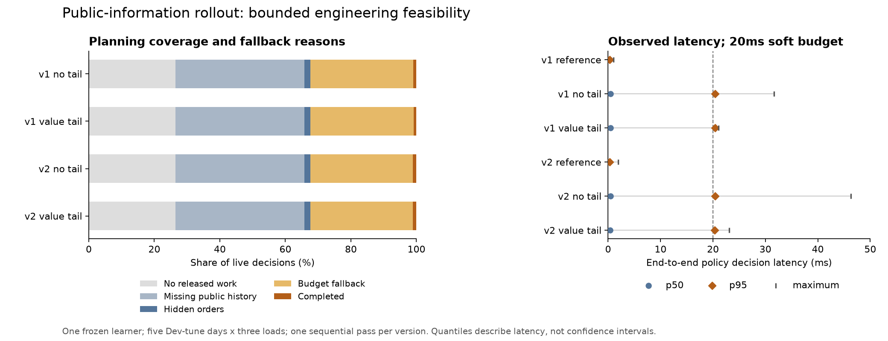

# Gen4 R4：公开信息短视规划的计算可行性

Engineering feasibility: one preselected frozen learner, five predetermined Dev-tune days x three loads, two implementation versions. No multi-seed method improvement claim; latency includes fallback/cold calls.

协议先于评估冻结：M=4、H=30 模拟分钟、20ms 软预算；真实未来订单与 demand seed 不进入 planner。v2 只改合成分支复制，并逐动作验证无预算时的分数和物理状态等价。

| 版本 | 策略 | Low % | Medium % | High % | 等权 % | reward 日均 | 推理 p50/p95/max ms |
|---|---|---:|---:|---:|---:|---:|---|
| v1 | reference | 98.75 | 87.51 | 77.12 | 87.79 | 39.451 | 0.257/0.286/1.015 |
| v1 | rollout_no_value | 98.75 | 87.51 | 77.12 | 87.79 | 39.451 | 0.431/20.408/31.645 |
| v1 | rollout_value | 98.75 | 87.51 | 77.12 | 87.79 | 39.451 | 0.437/20.426/21.072 |
| v2 | reference | 98.75 | 87.51 | 77.12 | 87.79 | 39.451 | 0.244/0.274/1.883 |
| v2 | rollout_no_value | 98.75 | 87.51 | 77.12 | 87.79 | 39.451 | 0.414/20.378/46.262 |
| v2 | rollout_value | 98.75 | 87.51 | 77.12 | 87.79 | 39.451 | 0.411/20.359/23.121 |

同一版本只使用一个预先固定的 learner；±跨种子标准差和确认性置信区间均未估计。这里的 87.79% 属于五个开发日，不能与旧 Test-v3 的 86.00% 相减为“提升”。

## 实际覆盖与额外计算

| 版本 | 规划 | 全部决策 | 信息足够状态 | 完成比较 | 完成/全部 % | 超时回退 | 改变动作 | 额外模拟 transitions |
|---|---|---:|---:|---:|---:|---:|---:|---:|
| v1 | rollout_no_value | 1765 | 572 | 17 | 0.96 | 555 | 4 | 23510 |
| v1 | rollout_value | 1765 | 572 | 16 | 0.91 | 556 | 4 | 21445 |
| v2 | rollout_no_value | 1765 | 572 | 19 | 1.08 | 553 | 4 | 26556 |
| v2 | rollout_value | 1765 | 572 | 19 | 1.08 | 553 | 4 | 24855 |

历史已经完成的订单，其释放时间戳不在当前 403 维观测中。当前原型拒绝无法还原最近到达历史的状态，每个规划版本有 695/1,765 次因此回退；隐藏待取订单 32 次，无已释放工作 466 次。这些是互斥回退原因，不能把全部回退归因于速度。

所有方法在每一个完整日的准时率均与原策略相同；四个规划版本各仅改变 4 次动作。这支持“当前 20ms 原型覆盖太低、未观察到服务收益”，不能推出规划一般无效。v2 完成比较从 16/17 次增至 19 次，仍只占约 1%，不构成实质工程晋级。

延迟是同一 CPU、单线程、顺序执行的完整决策计时，包含回退和冷启动首调用。20ms 是软预算，按宏模拟动作结束检查；最大观测超时仍完整保留，没有硬实时保证。这不是重复多轮的稳定微基准，不解读小幅计时差异为确定的加速率。

合计 96,366 额外模拟 transitions，90 个完整评估日（含重复原策略），只有 5 个独立需求日 ID、一个冻结 learner；真实训练 transitions 为 0。这些计数只覆盖两轮已登记评估，不含单状态 Train profiling 和单元测试的工程开销。No-value/value-tail 的额外模拟量必须与训练样本分开核算。

## 本轮决定与下一步

保留目的地网络与已验收快路径为正式默认，不因这组小样本改选方法、seed 或奖励。当前规划原型不进入大规模性能确认；先验证批量候选/情景推理能否提高固定预算下的完整比较覆盖。若加入公开历史记忆以重建到达历史，必须作为单独注册的状态/信息变化，不能偷偷读取 live simulator。

Dev-tune 只使用 100140–100144；Dev-confirm 及其余新开发日保持未评估，新 Final-Test 未生成。两个工程版本及其空结果全部保留；没有扩大 M/H/时间预算，也没有额外训练搜索。

逐日所有类型指标和费用在 JSON/压缩原始记录中。原始数据归档及成员 hash 由独立 manifest 索引；原始 source SHA 对应各自 Git 历史，不能用 v2 文件冒充 v1 的冻结源码。
