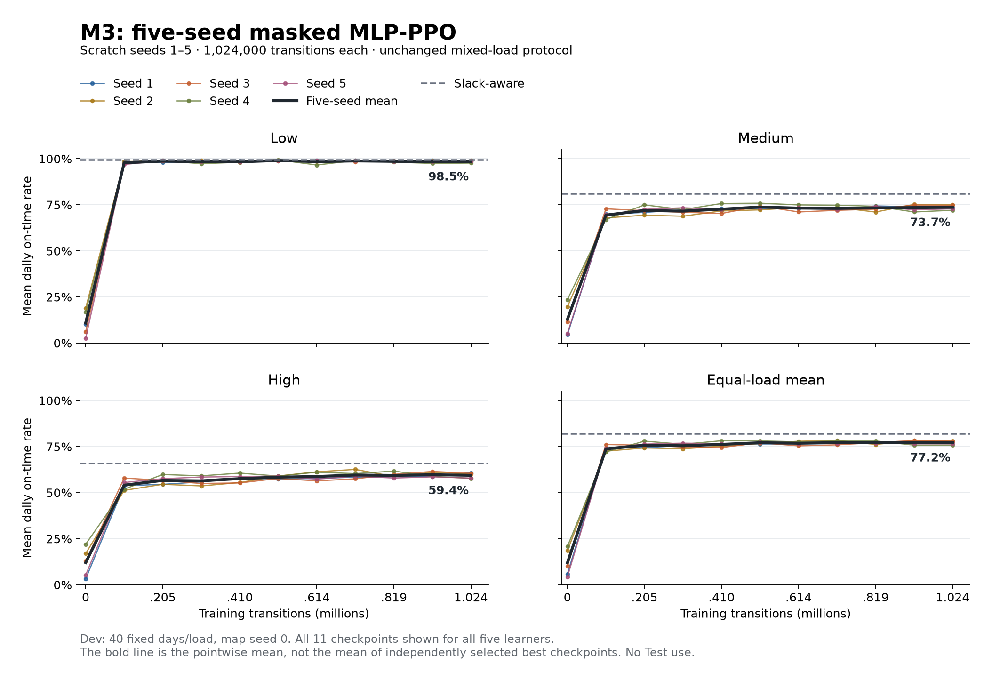
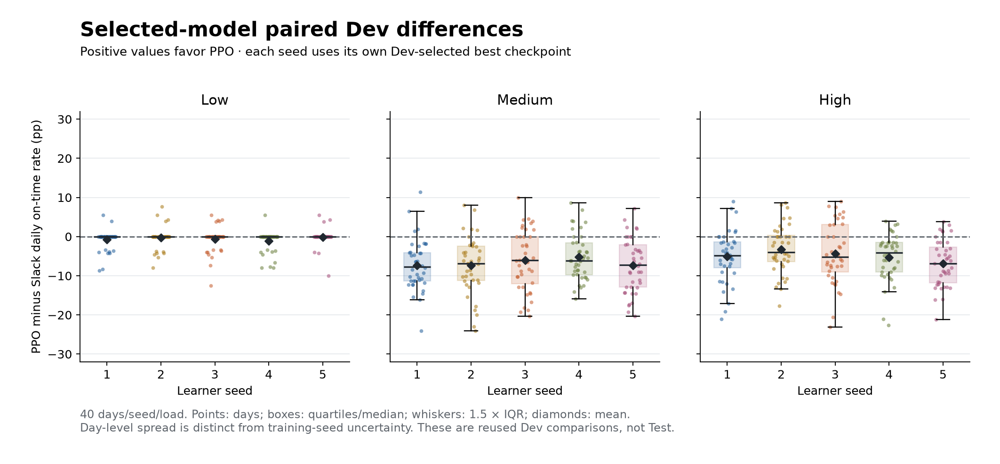

# M3 — Multi-seed MLP-PPO Baseline

Five scratch learner seeds; Dev only; full fixed budget for every run.

Dev-selected models average **77.97% ± 0.49 pp** across learner seeds, versus Slack-aware at 82.05% (paired mean gap -4.08 pp). Last models average 77.22% ± 0.98 pp.

Each cell is mean daily on-time rate (%); aggregate SD is sample SD across five learner seeds.

| Seed | Best step | Low | Medium | High | Equal mean | Last equal mean |
|---:|---:|---:|---:|---:|---:|---:|
| 1 | 1,024,000 | 98.50 | 73.67 | 60.82 | 77.66 | 77.66 |
| 2 | 716,800 | 98.96 | 73.60 | 62.65 | 78.40 | 78.10 |
| 3 | 921,600 | 98.61 | 74.90 | 61.52 | 78.35 | 77.94 |
| 4 | 409,600 | 98.16 | 75.74 | 60.63 | 78.18 | 75.85 |
| 5 | 512,000 | 99.15 | 73.61 | 59.01 | 77.26 | 76.52 |
| Mean ± SD | — | 98.68 ± 0.39 | 74.31 ± 0.97 | 60.93 ± 1.33 | 77.97 ± 0.49 | — |
| Slack-aware | — | 99.26 | 80.99 | 65.89 | 82.05 | — |
| EDF | — | 99.56 | 40.56 | 27.47 | 55.86 | — |
| Random, fixed seed-0 baseline | — | 51.14 | 23.55 | 21.28 | 31.99 | — |

## Last checkpoints at 1,024,000 transitions

| Seed | Low | Medium | High | Equal mean | Best minus last (pp) |
|---:|---:|---:|---:|---:|---:|
| 1 | 98.50 | 73.67 | 60.82 | 77.66 | 0.00 |
| 2 | 99.08 | 75.02 | 60.20 | 78.10 | 0.30 |
| 3 | 98.52 | 74.78 | 60.52 | 77.94 | 0.40 |
| 4 | 97.70 | 72.08 | 57.78 | 75.85 | 2.32 |
| 5 | 98.80 | 72.87 | 57.90 | 76.52 | 0.74 |
| Mean ± SD | 98.52 ± 0.51 | 73.68 ± 1.25 | 59.44 ± 1.48 | 77.22 ± 0.98 | — |

## Learning process

The bold curve is the pointwise mean at a common training budget, not an average of Dev-selected checkpoints.

| Load | Mean at 102,400 | Mean at 1,024,000 | Increase (pp) | Final interval change (pp) |
|---|---:|---:|---:|---:|
| Low | 97.85% | 98.52% | +0.67 | -0.02 |
| Medium | 69.45% | 73.68% | +4.23 | +0.17 |
| High | 54.08% | 59.44% | +5.36 | -0.30 |
| Mean | 73.79% | 77.22% | +3.42 | -0.05 |

Best checkpoints before the final budget: 2, 3, 4, 5.

The recorded tail changes describe the observed checkpoints. Small final changes or earlier best checkpoints do not prove convergence.

## Same-day differences against Slack-aware

| Load | Mean difference (pp) | SD across learner-seed mean differences (pp) | Days won by all five | Days lost by all five |
|---|---:|---:|---:|---:|
| Low | -0.59 | 0.39 | 1/40 | 1/40 |
| Medium | -6.68 | 0.97 | 1/40 | 20/40 |
| High | -4.97 | 1.33 | 2/40 | 17/40 |

The largest best-to-last loss is seed 4: 2.32 pp, while equal-load daily reward changed +0.549. Per-load changes in served rate, expiry rate, on-time rate and reward are retained in the JSON. Reward/on-time divergence is an observed tradeoff to investigate, not proof of a numerical failure or a single behavioral mechanism.

Boxes describe day-level variation. The table's SD describes learner-seed variation; these are distinct uncertainty sources.

## Sampling, health and elapsed time

| Seed | Complete training days | Low / Medium / High transitions | Training (s) | Dev (s) | Wall (s) |
|---:|---:|---|---:|---:|---:|
| 1 | 9,552 | 306,766 / 344,546 / 372,688 | 224.13 | 39.74 | 267.56 |
| 2 | 9,742 | 297,659 / 350,141 / 376,200 | 227.84 | 39.27 | 270.91 |
| 3 | 9,398 | 318,858 / 340,708 / 364,434 | 225.95 | 40.56 | 270.30 |
| 4 | 9,448 | 320,404 / 337,800 / 365,796 | 238.97 | 42.19 | 285.21 |
| 5 | 9,640 | 302,309 / 343,172 / 378,519 | 232.65 | 40.91 | 277.45 |

All 5,000 updates completed; illegal actions and non-finite recorded diagnostics were zero. All 55 archived model/optimizer states passed finite-tensor checks. There were 47,780 complete training episodes.

Total serial-run wall time: 1371.43 s; training stages 1149.54 s; Dev evaluation/logging 202.68 s. Orchestrator elapsed time: 1376.24 s.

## Artifacts and scope

Frozen training source commit: `6ba5af2f5adb99d9f9f5f6a200d53904b794edc6`.

All 55 complete Dev checkpoints, best/last models, day-level and update-level records are retained in the raw run directories.
The summary JSON preserves every seed/checkpoint, sampling counts, diagnostics, timings and paired statistics. The paired JSON preserves all 1,200 best/last day pairs.

Results are Dev-selected, with no Test use. No inference about the causal effect of mixed loads is supported without an equal-budget Medium-only control.
